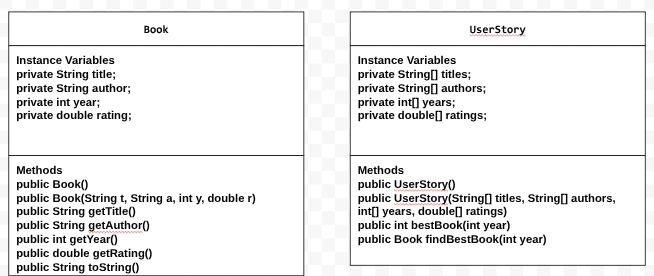

# dataforsocialgoodproject
Data for Social Good Project.
# Unit 2 - Data for Social Good Project

## Introduction

Software engineers develop programs to work with data and provide information to a user. Each user has different needs based on the information they are looking for from data. Your goal is to create a data analysis program for your user that stores and analyzes data to provide the information they need.

## Requirements

Use your knowledge of object-oriented programming, one-dimensional (1D) arrays, and algorithms to create your data analysis program:
- **Write a class** – Write a class to represent your user or business and store and analyze their data with no-argument and parameterized constructors.
- **Create at least two 1D arrays** – Create at least two 1D arrays to store the data that your user needs information about.
- **Write a method** – Write a method that finds or manipulates the elements in a 1D array to provide the information your user needs.
- **Implement a toString() method** – Write a toString() method that returns general information about the data (for example, number of values in the dataset).
- **Document your code** – Use comments to explain the purpose of the methods and code segments and note any preconditions and postconditions.

## User Story 

Include your User Story you analyzed for your project here. Your User Story should have the following format: 

As an avid reader, I want to view the best-rated literature sorted by publication date, so that I can quickly discover high-quality books from specific eras to expand and display my knowledge of the literary world and share my literary knowledge with my community.

## Dataset 

Include a hyperlink to the source of your dataset used for this project. Additionally, provide a short description of each column used from the dataset, and the data type. 

Dataset: https://www.kaggle.com/datasets/thedevastator/books-sales-and-ratings/data
- **Title** (String) - Name of the book 
- **Author** (String) - Author of the book
- **Year** (int) - Year the book was published
- **Rating** (double) - Average rating of the book

## UML Diagram 

Put an image of your UML Diagram here. Upload the image of your UML Diagram to your repository, then use the Markdown syntax to insert your image here. Make sure your image file name is one work, otherwise it might not properly get displayed on this README. 

 

## Description 

Write a description of your project here. In your description, include as many vocab words from our class to explain your User Story, the chosen dataset and how your project addressed that users goals. If your project used the Scanner class for user input, explain how the user will interact with your project.

My project is a program designed to help readers discover the highest-rated book published in a specific year. The program uses a dataset containing book titles, authors, publication years, and average ratings, which are organized into parallel 1D arrays using the FileReader class. I incorporated object-oriented programming by creating Book and UserStory classes, using private instance variables, no-argument and parameterized constructors, accessor methods, and a toString() method. The program uses iteration through a for loop and conditional statements such as if and if-else statements to search the dataset, filter books by the year it was published, adn compare the ratings to identify what book has the highest rating for that specific year. Additionally, I implemented the Scanner class in DataRunner.java to allow users to interact with the program by allowing them to enter the year they want to search and then displays the book title, author, average rating, and publication date, for that year or informs the user that there were no matching books for that year. By incorporating data analysis, user input, and object-oriented programming, I was able to help a user find highly rated books efficiently without having to manually search through a large dataset.